<p align="center">
  
</p>

<h1 align="center">AARUSHI SACHDEVA</h1>

<p align="center">
  
  &nbsp;
  
  &nbsp;
  
</p>

<p align="center">
  <a href="https://aarushisachdeva.vercel.app/"><b>Portfolio</b></a> &nbsp;&bull;&nbsp;
  <a href="https://github.com/sachdeva-aarushi"><b>GitHub</b></a> &nbsp;&bull;&nbsp;
  <a href="https://www.linkedin.com/in/aarushi-sachdeva/"><b>LinkedIn</b></a> &nbsp;&bull;&nbsp;
  <a href="mailto:aarushisachdeva6@gmail.com"><b>Email</b></a>
</p>

<p align="center">
  
</p>

<br>

<!-- ======================================================= -->
<!-- ABOUT ME SECTION -->
<!-- ======================================================= -->

<table>
  <tr>
    <td width="36%" align="center" valign="middle">
      
      <br>
      <sub><b>AARUSHI SACHDEVA</b></sub><br>
      <sub>AI/ML Engineer &bull; JSS University '29</sub>
    </td>
    <td width="64%" valign="top">
      <h3>&nbsp;<code>// THE DIRECTIVE</code></h3>
      <p>
        I don't build toy demos or wrap basic API endpoints and call it AI. I engineer intelligent systems that tackle messy, real-world operational complexity under pressure.
      </p>
      <p>
        Currently pursuing a <b>B.Tech in Computer Science (AI & ML)</b> at JSS University (<b>9.0 CGPA</b>), architecting autonomous agent workflows as an <b>AI/ML Developer at GDG OnCampus JSS</b>, shipping critical open-source patches in the <b>Global Top 2% of GSSoC 2026</b> (Rank #818 of 47k+), and competing as a <b>3x Hackathon Winner</b> who turns high-stress problem statements into functioning software by dawn.
      </p>
      <p>
        From industrial risk intelligence correlating spatiotemporal plant telemetry to multilingual multi-agent CTRM platforms and forensic civic-tech diff engines, my work lives at the convergence of <b>machine learning, systems architecture, and relentless execution</b>.
      </p>
      <details>
        <summary><b>&blacktriangleright; Core Operating Principles</b></summary>
        <br>
        <ul>
          <li>✦&nbsp; <b>First-Principles Engineering:</b> Understand the math and telemetry, not just the library wrappers.</li>
          <li>✦&nbsp; <b>Deterministic Guardrails:</b> Safety-governed advisory layers over hallucinatory LLM outputs.</li>
          <li>✦&nbsp; <b>High Velocity, Zero Fluff:</b> Idea &rarr; prototype &rarr; stress-test &rarr; production deployment.</li>
          <li>✦&nbsp; <b>Thoughtful UI/UX:</b> Even complex agentic backends deserve intuitive, art-directed interfaces.</li>
        </ul>
      </details>
    </td>
  </tr>
</table>

<br>

<!-- ======================================================= -->
<!-- RADAR / TARGET LOCK CALLOUT -->
<!-- ======================================================= -->

<table>
  <tr>
    <td width="30%" align="center" valign="middle">
      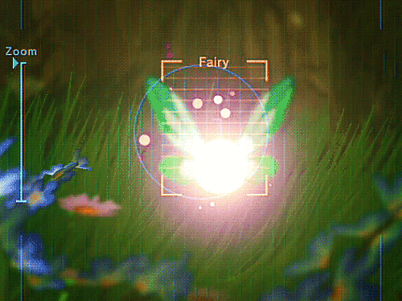
      <br>
      <sub><code>[STATUS: TARGET_LOCKED]</code></sub>
    </td>
    <td width="70%" valign="top">
      <h4>&nbsp;<code>// TARGET ACQUISITION: REAL-WORLD SYSTEMS</code></h4>
      <p>
        Every architecture I design is locked onto an actual operational bottleneck. If a system doesn't move needles in <b>industrial safety</b>, <b>commodity liquidity</b>, <b>electoral integrity</b>, or <b>clinical procurement</b>, it doesn't leave my local branch.
      </p>
      <p>
        <b>Quick Telemetry:</b>
        <br>
        ✦ <b>3x Hackathon Winner</b> &bull; SnowFrost '26 &bull; InOutHacks '26 &bull; SheBuilds Global
        <br>
        ✦ <b>Global Rank #818 / 47,935</b> &bull; GirlScript Summer of Code 2026 (Top 2%)
        <br>
        ✦ <b>Global Rank #93</b> &bull; Smartly Infra AI Agents Track
        <br>
        ✦ <b>Top 210 Builders Worldwide</b> &bull; SheBuilds S3 by Lovable (Selected from 3,000+ applicants)
      </p>
    </td>
  </tr>
</table>

<p align="center">
  
</p>

<!-- ======================================================= -->
<!-- TECHNICAL REPERTOIRE (SKILLS & TECH STACK CARDS) -->
<!-- ======================================================= -->

## &nbsp;Technical Repertoire

Curated engineering domains, autonomous paradigms, and production frameworks engineered for high throughput and deterministic reliability.

<p align="center">
  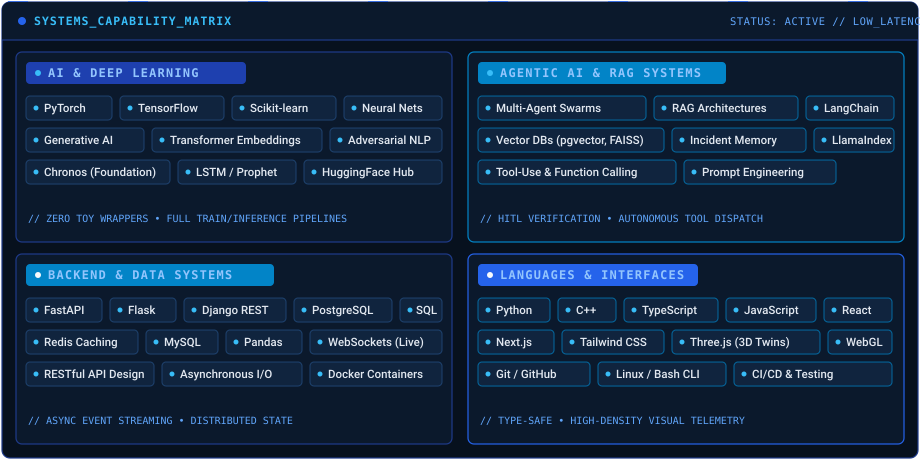
</p>

<details>
  <summary><b>&blacktriangleright; Detailed Framework &amp; Tooling Breakdown</b></summary>
  <br>
  <table>
    <tr>
      <td width="50%" valign="top">
        <p><b>&bull; AI &amp; DEEP LEARNING</b></p>
        <code>PyTorch</code> &bull; <code>TensorFlow</code> &bull; <code>Scikit-learn</code> &bull; <code>Neural Networks</code> &bull; <code>Generative AI</code> &bull; <code>Transformer Embeddings</code> &bull; <code>Adversarial NLP</code> &bull; <code>Chronos Foundation Models</code> &bull; <code>LSTM / Prophet</code> &bull; <code>HuggingFace Hub</code>
        <br><br>
        <p><b>&bull; AGENTIC AI &amp; RAG ARCHITECTURES</b></p>
        <code>Multi-Agent Swarms</code> &bull; <code>RAG Architectures</code> &bull; <code>Vector DBs (pgvector, FAISS)</code> &bull; <code>Incident Memory</code> &bull; <code>Tool-Use &amp; Function Calling</code> &bull; <code>Prompt Engineering</code> &bull; <code>LangChain</code> &bull; <code>LlamaIndex</code>
      </td>
      <td width="50%" valign="top">
        <p><b>&bull; BACKEND &amp; DATA SYSTEMS</b></p>
        <code>FastAPI</code> &bull; <code>Flask</code> &bull; <code>Django REST Framework</code> &bull; <code>PostgreSQL</code> &bull; <code>Redis Caching</code> &bull; <code>MySQL</code> &bull; <code>Pandas</code> &bull; <code>WebSockets (Live Stream)</code> &bull; <code>RESTful APIs</code> &bull; <code>Docker</code>
        <br><br>
        <p><b>&bull; LANGUAGES &amp; INTERFACES</b></p>
        <code>Python</code> &bull; <code>C++</code> &bull; <code>TypeScript</code> &bull; <code>JavaScript</code> &bull; <code>SQL</code> &bull; <code>React</code> &bull; <code>Next.js</code> &bull; <code>Tailwind CSS</code> &bull; <code>Three.js (3D Digital Twins)</code> &bull; <code>Git / GitHub</code> &bull; <code>Linux CLI</code>
      </td>
    </tr>
  </table>
</details>

<br>

<div align="center">
  
</div>

<details>
  <summary><b>&blacktriangleright; Architecture &amp; Implementation Philosophy</b></summary>
  <br>
  <blockquote>
    "I prioritize deterministic guardrails over ungrounded generative prompts, low-latency asynchronous telemetry over blocking batch calls, and zero direct actuator writes without human-in-the-loop safety protocols."
  </blockquote>
</details>

<p align="center">
  
</p>

<!-- ======================================================= -->
<!-- ALL PROJECTS IN ONE MASTER SECTION -->
<!-- ======================================================= -->

## &nbsp;Engineering Portfolio & Systems

<p>
  <i>Curated production systems, autonomous multi-agent architectures, and award-winning hackathon solutions &mdash; styled in low-latency blue telemetry cards. Click any card to launch its repository.</i>
</p>

<br>

<table>
  <!-- ROW 1: NOVA & TRADENEXUS -->
  <tr>
    <td width="50%" valign="top">
      <a href="https://github.com/sachdeva-aarushi/nova">
        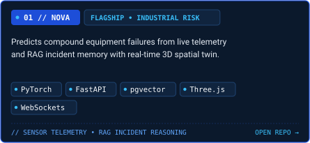
      </a>
    </td>
    <td width="50%" valign="top">
      <a href="https://github.com/sachdeva-aarushi/TradeNexus">
        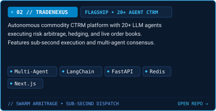
      </a>
    </td>
  </tr>
  <!-- ROW 2: MATSETU & AGROCHAIN -->
  <tr>
    <td width="50%" valign="top">
      <a href="https://github.com/sachdeva-aarushi/MatSetu">
        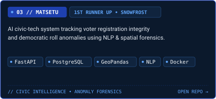
      </a>
    </td>
    <td width="50%" valign="top">
      <a href="https://github.com/sachdeva-aarushi/AgroChain">
        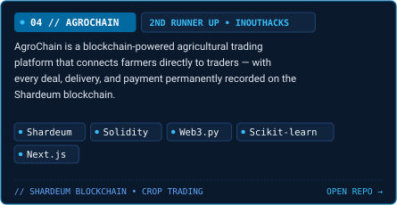
      </a>
    </td>
  </tr>
  <!-- ROW 3: GITINTEL & KYRO -->
  <tr>
    <td width="50%" valign="top">
      <a href="https://github.com/sachdeva-aarushi/GitIntel">
        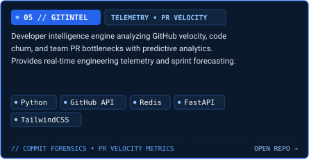
      </a>
    </td>
    <td width="50%" valign="top">
      <a href="https://github.com/sachdeva-aarushi/Kyro">
        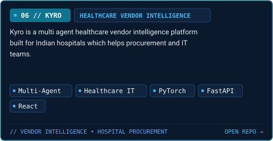
      </a>
    </td>
  </tr>
  <!-- ROW 4: NARRATIVE TOXICITY DETECTOR & NIMA -->
  <tr>
    <td width="50%" valign="top">
      <a href="https://github.com/sachdeva-aarushi/narrative-toxicity-detector">
        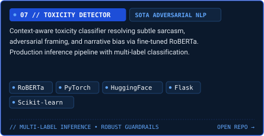
      </a>
    </td>
    <td width="50%" valign="top">
      <a href="https://github.com/sachdeva-aarushi/Nima">
        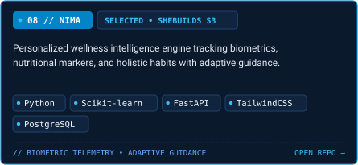
      </a>
    </td>
  </tr>
</table>

<br>

<!-- EXPERIENCE & OPEN SOURCE -->
<!-- ======================================================= -->

## &nbsp;Experience & Open Source Leadership

<p align="center">
  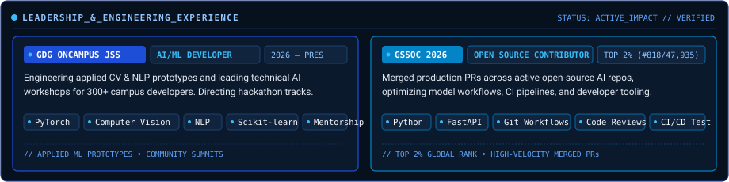
</p>

<p align="center">
  <a href="https://gssoc.girlscript.org/profile/85b6e6df-a366-4ee2-bc18-1ef150b311a8"></a>
  &nbsp;
  <a href="https://github.com/sachdeva-aarushi"></a>
</p>

<br>

<!-- HONORS & ACHIEVEMENTS -->
<!-- ======================================================= -->

## &nbsp;Honors & Verified Achievements

<table>
  <tr>
    <td width="20%" align="center">
      <p><b>SnowFrost '26</b></p>
      
      <br>
      <sub>Jamia Hamdard</sub>
    </td>
    <td width="20%" align="center">
      <p><b>InOutHacks '26</b></p>
      
      <br>
      <sub>JSS University</sub>
    </td>
    <td width="20%" align="center">
      <p><b>TGL Blitz '26</b></p>
      
      <br>
      <sub>JSS University</sub>
    </td>
    <td width="20%" align="center">
      <p><b>SheBuilds S3</b></p>
      
      <br>
      <sub>3,000+ Applicants</sub>
    </td>
    <td width="20%" align="center">
      <p><b>GSSoC 2026</b></p>
      
      <br>
      <sub>47,935 Builders</sub>
    </td>
  </tr>
</table>

<p align="center">
  
</p>

<!-- ======================================================= -->
<!-- GITHUB TELEMETRY -->
<!-- ======================================================= -->

## &nbsp;Live Engineering Telemetry

<p align="center">
  
  &nbsp;
  
</p>

<p align="center">
  
</p>

<!-- ======================================================= -->
<!-- WHAT'S KEEPING ME CURIOUS -->
<!-- ======================================================= -->

## &nbsp;What's Keeping Me Curious

```
✦ Deterministic safety layers & agentic execution guardrails
✦ Spatiotemporal telemetry correlation in physical-digital industrial twins
✦ Multi-horizon commodity price forecasting using Chronos & Prophet ensembles
✦ Sparse-dense hybrid RAG retrieval with pgvector & FAISS incident indexing
✦ Low-latency async architectures for real-time telemetry streaming
```

<br>

<!-- ======================================================= -->
<!-- CLOSING & FLOURISH -->
<!-- ======================================================= -->

<p align="center">
  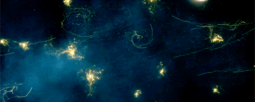
</p>

<p align="center">
  <i>Still curious. Still building. Still figuring things out.</i>
</p>

<p align="center">
  <a href="https://aarushisachdeva.vercel.app/">Portfolio</a> &nbsp;&bull;&nbsp;
  <a href="https://github.com/sachdeva-aarushi">GitHub</a> &nbsp;&bull;&nbsp;
  <a href="https://www.linkedin.com/in/aarushi-sachdeva/">LinkedIn</a> &nbsp;&bull;&nbsp;
  <a href="mailto:aarushisachdeva6@gmail.com">aarushisachdeva6@gmail.com</a>
</p>

<p align="center">
  <sub>Engineered with celestial bioluminescence &bull; 2026</sub>
</p>
